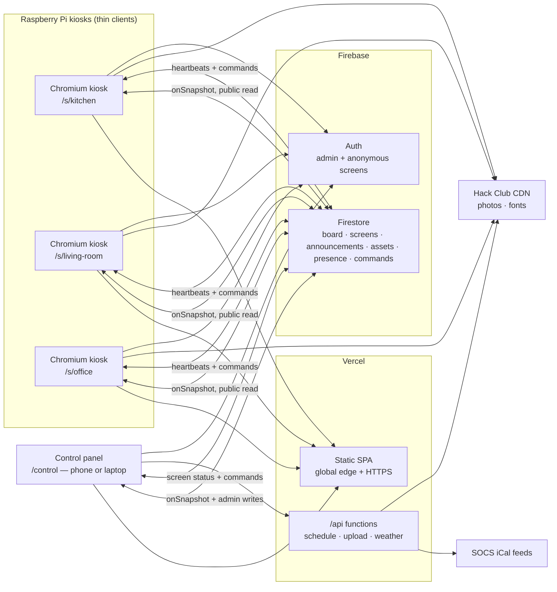

# Cardboard — Build Plan

A realtime dashboard for TV kiosks. One control panel, many Raspberry Pi thin clients, no reloads.

**Stack:** Vercel (SPA + serverless functions) · Firestore (board, presence and commands) · Firebase Auth (admin and anonymous screens) · Hack Club CDN (images and fonts) · SOCS iCalendar feed for the school schedule.

---

## 1. Shape of the system

- **Vercel** serves the Vite/React SPA and a small `/api/*` layer. No long-lived server, no WebSocket — Firestore listeners do the realtime work.
- **Firestore** holds one board document (pages, cards, theme, settings), screen records, announcements, assets, and revisions. Screens read it **publicly**; only the admin can write.
- **Firestore** also holds ephemeral state: screen heartbeats and one-shot commands (reload, go to page, blank). Screens heartbeat every 45 seconds and the panel considers them online for 120 seconds.
- **Hack Club CDN** stores uploaded photos and fonts. Uploads are immutable and URLs are permanent, which is exactly right for a dashboard.
- **SOCS** exposes an iCalendar feed behind its week view. The feed URL is chosen in Settings, stored server-side in a private doc, and never written into the public board document. A Vercel function fetches, parses, expands recurrences, and serves normalized JSON with edge caching.

Why this split: Vercel is the cheapest place to put a static bundle plus two or three tiny functions, Firestore's listener + offline cache is the best fit for a Pi that must survive a dropped connection, and HC CDN keeps binary assets off both.

At this scale the whole thing is **$0/month** (Vercel Hobby, Firebase Spark, HC CDN free tier). See §13 for limits.

---

## 2. Architecture



**Read path:** every screen listens to `boards/{id}/config`. A change in control is one atomic Firestore write; screens repaint in ~100–400 ms. The control panel updates optimistically, so the editor reacts in the same frame and reconciles when the server snapshot lands.

**Write path:** only the admin can write, enforced by security rules — not by hiding buttons.

**Offline:** Firestore's IndexedDB cache means a Pi that loses Wi-Fi keeps rendering the last board. The app shell and images are service-worker cached. Clock, countdown, and quotes are fully local. An "offline" chip appears only in the control panel.

---

## 3. Why not the alternatives

| | **This plan** | All-Firebase (Hosting + Functions) | VPS + Node/Postgres |
|---|---|---|---|
| Hosting | Vercel, instant deploys, previews | Firebase Hosting | You run it |
| Functions | Vercel, generous free tier | Cloud Functions needs Blaze | You run it |
| Realtime | Firestore listeners | Same | Build WebSockets |
| Offline on Pi | Firestore SDK | Same | Build it |
| Ops | ~zero | ~zero | TLS, backups, uptime |
| Cost | $0 | $0 + Blaze | $5–10/mo |

Keep a `BoardStore` interface and full JSON export/import so Firestore isn't welded into the domain code. That's the insurance policy against lock-in.

**Frontend:** Vite + React 19 + TypeScript + Tailwind 4. Not Next.js — there is nothing to SSR for a kiosk, and a static bundle is the fastest thing a Pi can load. Routes are code-split so the kiosk never downloads the editor.

**Libraries:** `zod` (one schema per card, shared by forms/validation/functions), `react-grid-layout` (control only), `date-fns` + `date-fns-tz`, `node-ical` (SOCS), `marked` + `dompurify`, `firebase` SDK.

---

## 4. Data model

```ts
// boards/{boardId}/config — the whole board in one doc
type BoardConfig = {
  version: number;              // increments on every write
  updatedAt: Timestamp;
  settings: {
    name: string;
    defaultPageId: string;
    locale: string;             // "en-GB"
    timezone: string;           // "Europe/London"
    rotation: { enabled: boolean; pageIds: string[]; intervalSec: number };
    maintenance: { reloadAt: string | null; blankOutsideHours: boolean };
  };
  theme: Theme;
  pages: Page[];
};

type Page = {
  id: string;
  name: string;
  theme?: Partial<Theme>;       // per-page override
  background?: Background;
  transition: "fade" | "slide" | "none";
  cards: Card[];                // array order = z-order
};

type Card = {
  id: string;
  type: "clock" | "weather" | "quote" | "photo" | "iframe" | "schedule" | "markdown" | "image" | "countdown";
  layout: { x: number; y: number; w: number; h: number };  // 24-col grid
  visible: boolean;
  refreshSec?: number;
  style?: Partial<CardStyle>;   // bg, opacity, blur, padding, radius, align
  config: unknown;              // validated by the card's zod schema
};

type Theme = {
  mode: "dark" | "light" | "auto";
  colors: { bg: string; surface: string; text: string; muted: string; accent: string; border: string };
  font: { display: string; body: string; scale: number; weight: number };
  radius: number; shadow: string; gap: number; rowHeight: number; gridCols: 24;
  card: { opacity: number; blur: number; border: boolean };
  background: Background;
  animations: { enabled: boolean; durationMs: number };
};

type Background =
  | { type: "solid"; color: string }
  | { type: "gradient"; from: string; to: string; angle: number }
  | { type: "image"; url: string; dim: number; blur: number; fit: "cover" | "contain" };
```

```ts
// boards/{boardId}/screens/{screenId} — public read
type Screen = {
  id: string;                   // also the presence key, e.g. "kitchen-7f3a"
  name: string;                 // "Kitchen"
  assignedPageId?: string | null; // legacy single-page assignment
  pageIds?: string[] | null;    // custom page selection; null = default/main selection
  revoked?: boolean;
  createdAt: Timestamp;
  meta?: { ua: string; width: number; height: number };
};

// boards/{boardId}/announcements/{id} — public read
type Announcement = {
  id: string;
  title?: string;
  body: string;                 // markdown
  tone: "info" | "success" | "warning" | "urgent";
  style: "overlay" | "banner" | "ticker";
  durationSec: number | null;   // null = until dismissed
  target: { type: "all" } | { type: "screens"; ids: string[] } | { type: "pages"; ids: string[] };
  startsAt?: Timestamp;
  expiresAt?: Timestamp;
  createdAt: Timestamp;
};

// boards/{boardId}/assets/{id} — public read
type Asset = {
  cdnId: string;                // HC CDN upload id
  url: string;                  // https://cdn.hackclub.com/<uuid>/<file>
  name: string;
  width: number;
  height: number;
  bytes: number;
  createdAt: Timestamp;
};

// boards/{boardId}/revisions/{id} — admin only
type Revision = { config: BoardConfig; createdAt: Timestamp };

// boards/{boardId}/scheduleMeta — public, never contains the feed URL
type ScheduleMeta = {
  revision: number;             // bumped when the feed changes; used as the cache key
  updatedAt: Timestamp;
  lastFetchAt?: Timestamp;
  lastError?: string;
  eventCount?: number;
};

// boards/{boardId}/scheduleCache — public, last good normalized window
type ScheduleEvent = {
  id: string; title: string; start: string; end: string;
  allDay: boolean; location?: string; categories: string[]; description?: string;
};
type ScheduleCache = { revision: number; fetchedAt: Timestamp; events: ScheduleEvent[] };

// boards/{boardId}/private/{doc} — deny all client reads and writes
// private/feeds = {
//   calendar: {
//     source: "socs-page" | "ical",
//     pageUrl?: string,          // what the admin pasted, e.g. .../week.aspx?ID=...
//     icalUrl: string,           // resolved CalendarSync.ashx / .ics URL
//     includeInternal: boolean,  // SOCS "approved" scope
//     updatedAt: Timestamp
//   }
// }
```

```ts
// Firestore subcollections — ephemeral screen state
boards/{boardId}/screens/{screenId} = {
  online: true, pageId: string, at: number, ua: string, w: number, h: number
}                              // stale after the 120-second online window

boards/{boardId}/screens/{screenId}/commands/{cmdId} = {
  type: "reload" | "goto" | "next" | "blank" | "identify" | "clear-cache",
  payload?: unknown, at: number
}                              // screen deletes after executing
```

If the board doc ever approaches 1 MB (≈10 pages × 15 cards), shard pages into `boards/{id}/pages/{pageId}`. Design the store interface so that's a one-file change, but don't do it on day one.

---

## 5. Public screens & security

Screens are **publicly readable** — anyone with the URL sees the board. That's the explicit choice, and it makes pairing trivial: no tokens, no claims, no auth screen for the TV.

- **Read:** `allow read: if true` on `config`, `screens`, `announcements`, `assets`, `scheduleMeta`, and `scheduleCache`. Unauthenticated Firestore listeners work out of the box.
- **Write:** `allow write: if isAdmin()` everywhere. Admin is a Firebase Auth user with a `role: "admin"` custom claim, set once by a script or the console.
- **Presence:** screens sign in **anonymously** (enable the provider) and write their own Firestore node. That gives you a real identity for presence/commands without exposing anything sensitive. If you'd rather skip anonymous auth, presence can be public-write keyed by an unguessable slug — harmless, just spoofable.
- **Calendar URL is server-side only.** Settings accepts a SOCS week-view page or a direct iCal/webcal URL. It writes through `PUT /api/settings/feeds`, which verifies the Firebase ID token and the `role: "admin"` claim, then stores the URL in `boards/{id}/private/feeds` with rules `allow read, write: if false` (Admin SDK bypasses rules). `GET /api/settings/feeds` returns it masked (`••••` + last 6 chars) with a "reveal" action; the raw value is never in the SPA bundle, the public board doc, or `scheduleMeta`.
- **Uploads:** `/api/upload` holds the `sk_cdn_...` key server-side, forwards to HC CDN, returns the permanent URL. The browser never sees the key.
- **Consequence of public read:** anything in the board doc is world-readable. That includes iframe URLs, photo URLs, and calendar event details. Keep secrets out; don't put private family photos on the TV unless you're happy with a public URL.
- **Hardening:** `/control` route guard, Firebase Auth rate limits, `vercel.json` security headers, DOMPurify on markdown, iframe `sandbox` + optional domain allowlist, upload MIME/size checks, and a per-IP rate limit on `/api/upload` and `/api/schedule`.

Threat model is "school/family dashboard on the public internet", not a bank. The real risks are a leaked admin password and an abused upload endpoint.

---

## 6. Realtime & sync

| Concern | Approach |
|---|---|
| Config propagation | `onSnapshot` on the single board doc |
| Editor feel | Optimistic local state, 250 ms debounced writes, reconcile on snapshot |
| Conflicts | Last-write-wins on `version`; single editor in practice |
| Announcement latency | Firestore listener, typically <500 ms |
| Presence | Firestore heartbeat timeout, heartbeat every 20 s |
| Commands | Firestore push; screen executes and deletes |
| Reconnect | SDK handles it; snapshot resyncs, no manual diffing |
| Clock/date | Local `Intl`, never network |
| Deploy drift | `version.json` polled every 5 min; reload only at the maintenance window or when idle |

Target: **< 1 s from keystroke in control to pixels on the TV**, with the control panel itself reacting immediately.

---

## 7. Display client (`/` and `/s/:screenId`)

- Full-bleed 16:9 canvas, no scrollbars, cursor hidden, context menu disabled.
- All sizing in **container query units (`cqw`/`cqh`)**, so the control-panel preview and the TV use the same renderer and match pixel-for-pixel.
- Shared `PageRenderer` with the layout math in `shared/layout.ts`:
  ```
  colW = (W - gap*(24-1)) / 24
  x_px = x * (colW + gap)
  w_px = w * colW + (w-1) * gap
  ```
- Page transitions: fade / slide / none. Rotation every N seconds, or a page forced per screen.
- Announcement layer above everything: overlay (scrim + centered card), banner (top), ticker (bottom), countdown ring, auto-dismiss, queue.
- Self-healing: error boundary reloads after 3 s; `visibilitychange` resyncs; optional nightly reload; blank outside configured hours.
- Wake Lock where supported; Chromium launched with `--autoplay-policy=no-user-gesture-required` for announcement chimes.
- Offline: Firestore cache + service-worker shell + HC CDN images cached. Stale badge only after 10 minutes.
- **No video backgrounds.** Image backgrounds are static, pre-sized, and lazy-decoded.

---

## 8. Control panel (`/control`)

**Layout**
- Top bar: board name, save status, preview size toggle, "Open display", account.
- Left rail: Pages · Screens · Announcements · Theme · Settings.
- Center: WYSIWYG canvas at 16:9, zoom-to-fit, safe-area guides, 24-col snap grid, drag from palette, resize handles, alignment guides, multi-select, z-order.
- Right: inspector generated from each card's field descriptors, so new card types get UI for free.
- Keyboard: arrows nudge, `⌘Z`/`⇧⌘Z`, `⌘D`, `Delete`, `Esc`.
- Phone-friendly: simplified inspector, pinch-zoom canvas. You'll edit from the sofa.

**Pages:** add, rename, duplicate, reorder, delete, set default, per-page theme/background override.

**Screens:** live online/offline list with count, current page, resolution, last seen; rename, assign page, remote commands (reload, go to page, next, blank, identify/flash, clear cache); revoke.

**Announcements:** compose title/body/tone/style/duration/target, schedule window, preview, send/cancel, history and resend.

**Theme:** color tokens, font family/scale/weight, radius/shadow/gap/row height, card opacity/blur/border, background (solid/gradient/image with dim/blur), animation toggle, presets, import/export JSON, raw CSS escape hatch.

**Undo/redo:** 50 in-memory snapshots grouped per interaction (a drag is one commit) plus the last 100 revisions in Firestore.

**Media:** drag-and-drop upload → client-side resize to WebP (max 2560 px, ≤4 MB) → `/api/upload` → HC CDN URL stored in `assets`. Shows HC CDN quota from `/api/v4/me` and warns at 80%.

**Settings → Calendar:** paste the SOCS calendar page (`…/week.aspx?ID=…`) or the direct iCal/webcal link; the server discovers and resolves the feed. Toggle **include internal (approved) events**; "Test" fetches and previews the next five events; set refresh interval, days ahead, category filters, and whether event descriptions/links are shown. Saving bumps `scheduleMeta.revision`, which changes the `/api/schedule` cache key so the board updates immediately. Errors surface as `lastError` with a retry button.

---

## 9. Card system

One registry entry is the whole contract:

```ts
export const weatherCard = defineCard({
  type: "weather",
  name: "Weather",
  icon: CloudSun,
  defaultSize: { w: 6, h: 4 },
  schema: z.object({
    location: z.object({ lat: z.number(), lon: z.number(), label: z.string() }),
    units: z.enum(["metric", "imperial"]).default("metric"),
    days: z.number().min(0).max(7).default(3),
    layout: z.enum(["compact", "full"]).default("compact"),
  }),
  fields: [
    { key: "location", type: "location" },
    { key: "units", type: "select", options: [...] },
    { key: "days", type: "number", min: 0, max: 7 },
  ],
  refreshSec: 600,
  Component: WeatherCard,
});
```

| Card | Source | Notes |
|---|---|---|
| Clock / date | Local `Intl` | timezone, 12/24h, seconds, analog, multiple cities |
| Weather | Open-Meteo (no key, CORS-friendly) | current + hourly + N-day; cached 10 min; optional `/api/weather` proxy |
| Quote | Bundled JSON (~300) | deterministic daily/hourly pick |
| Photo | HC CDN upload / URL | single or slideshow, crossfade, Ken Burns, object-fit |
| Image | HC CDN upload / URL | static, caption |
| iFrame | URL | sandbox, refresh interval, allowlist; **cannot bypass X-Frame-Options** — show a friendly fallback |
| Schedule / agenda | **SOCS iCal via `/api/schedule`** | next 7 days, categories, all-day events, location |
| Markdown / text | Local | sanitized |
| Countdown | Local | target date, label, days/hours |

**Later:** generic JSON API card (allowlisted hosts), RSS, stocks, Home Assistant, Immich, multiple boards.

**Data flow:** data cards hit `/api/*` or a CORS-friendly host directly. Functions cache upstream responses (edge `s-maxage`, plus a short in-memory cache) so ten screens showing the same weather or timetable cost one upstream request.

### SOCS schedule specifics

The SOCS week view is HTML, but it links to a real iCalendar feed — no scraping needed. The page contains `webcal://…/CalendarSync.ashx?…` links (one for *published* events, one with `A=1` for *approved/internal* events), and the same URL over `https` returns `text/calendar`. That feed is the integration point.

**Settings flow**
1. Admin pastes either the week-view page or a direct iCal/webcal URL.
2. `PUT /api/settings/feeds` verifies the admin token, then resolves it: a page is fetched once, its `webcal://` / `CalendarSync.ashx` links are extracted, `webcal://` is rewritten to `https://`, and the variant is chosen by the "include internal events" toggle.
3. The resolved URL is stored in `private/feeds` (client-inaccessible), `scheduleMeta.revision` is incremented, and a test response is returned with the next few events.
4. Invalid URLs, non-calendar responses, or fetch failures are reported without echoing the URL back into any public document or log line.

**`/api/schedule`**
1. Reads `private/feeds.calendar` with the Admin SDK (service account in Vercel env).
2. Fetches with a browser-like UA and a 10 s timeout. Upstream sends `Cache-Control: private` and no CORS headers, so the proxy is mandatory and our own cache headers do the work.
3. Parses with `node-ical`; handles `VALUE=DATE` all-day events, `TZID=GMT Standard Time` (map to `Europe/London`), and expands the handful of `RRULE`s over the requested window.
4. Splits comma-separated `CATEGORIES` into tokens (`Sport`, `Football`, `Fixture`, `Senior School`, …) and filters by the card's selected categories.
5. Merges, de-dupes by `UID`, sorts, and returns `{ events: [{ id, title, start, end, allDay, location, categories, description? }] }`.
6. Sends `Cache-Control: s-maxage=300, stale-while-revalidate=600`, keyed by `?r=<scheduleMeta.revision>` so a Settings change busts the edge cache immediately.
7. Writes the normalized window to `scheduleCache` (public; events are public anyway) so a SOCS outage still serves the last good agenda.

The feed is large (~300 KB, 700+ events spanning multiple academic years), so parse only the requested window (default today + 14 days) and never ship the raw feed to the client.

The card renders an agenda (today + next 7 days) with a compact "next up" variant. Category colors live in the card config, not SOCS. Event descriptions and their `EventDetails.aspx` links are **off by default** — they add little on a TV and would leak the calendar's internal ID.

**URL secrecy:** the feed URL, calendar name, and numeric calendar ID never appear in `config`, `scheduleMeta`, `scheduleCache`, the SPA bundle, or function logs. Only normalized event fields reach the display.

---

## 10. Kiosk setup (Raspberry Pi)

- Raspberry Pi OS Lite 64-bit + Chromium; **Pi 4 (2 GB+) or Pi 5** recommended. Pi Zero 2 W only with performance mode on.
- `systemd` unit starts Chromium in `--kiosk --app=https://board.example.com/s/kitchen` with `Restart=always`.
- Disable blanking (`xset s off -dpms` on X11; console blanking on Wayland), hide cursor (`unclutter`), autologin.
- Provisioning script writes the screen ID to `/boot/firmware/cardboard.conf` and builds the URL. Reflash-and-go for a new TV.
- Nightly reload at 03:30 plus the `version.json` check picks up Vercel deploys without ever showing a stale UI.
- `docs/kiosk.md` with copy-paste commands; "Add screen" in the panel shows a QR code for the kiosk URL.

---

## 11. Repo structure

```
cardboard/
  src/
    display/                # /screen/:screenId — kiosk renderer
    control/                # /control — editor
    cards/                  # registry, renderers, zod schemas, field descriptors
    lib/                    # firebase, layout, theme→CSS vars, hooks
    styles/
  api/                      # Vercel serverless functions (Node)
    schedule.ts             # SOCS iCal fetch + parse + edge/DB cache
    settings/feeds.ts       # GET/PUT private calendar feed config (admin only)
    upload.ts               # HC CDN upload proxy
    weather.ts              # optional Open-Meteo proxy/cache
    _lib/                   # Admin SDK, ID-token verification, rate limit, redaction
  shared/                   # types + schemas shared by web and api
  scripts/                  # set-admin, seed-demo-board
  firebase.json             # Firestore/Firestore rules deploy only
  firestore.rules
  vercel.json               # SPA rewrites, headers, function config
  docs/kiosk.md
  PLAN.md
```

`vercel.json` essentials: rewrite everything except `/api/*` to `/index.html`; `index.html` and `version.json` `no-store`; `/assets/*` immutable; service worker `no-cache`; functions `maxDuration: 10`.

---

## 12. Milestones

**M0 — Walking skeleton (1–2 days)**
Repo, Vite + React + TS, Firebase project + emulators, Vercel project + deploy, admin login, Firestore listener, display shell with a clock card, control can change a theme color and add a markdown card.
*Done when:* the deployed URL on a phone updates a second tab in under a second.

**M1 — Real editor (≈1 week)**
Pages CRUD + reorder, card palette, drag/resize/snap, generated inspector, theme editor, undo/redo, preview scaling, phone layout. Cards: clock, markdown, image, photo, iframe, weather, quote.
*Done when:* a 3-page, 8-card board can be built from scratch on a phone with no code.

**M2 — Screens & announcements (≈1 week)**
Public-read rules, anonymous screen auth, presence list + count, remote commands, per-screen page assignment, rotation, announcements (overlay/banner/ticker, targeting, timed dismiss), kiosk provisioning script + docs, offline cache, nightly reload.
*Done when:* two Pis show different pages, both appear in the panel, and an announcement lands on one within a second and disappears on schedule.

**M3 — Data & media (≈1 week)**
Settings → Calendar (paste URL, discover/resolve feed, scope toggle, test, save to private doc), SOCS `/api/schedule` + agenda card + `scheduleCache` fallback, HC CDN upload/mirror/delete + asset library + quota display, theme presets, board import/export, revisions browser, security headers, rate limits, Playwright suite against emulators, CI deploy on `main`.
*Done when:* the real SOCS feed renders as an agenda, changing the feed in Settings takes effect within a minute without the URL appearing anywhere public, a photo uploads to HC CDN from the phone, and CI catches a broken deploy.

**M4 — Later**
Generic API card, RSS, countdown, Home Assistant/Immich, multiple boards, multi-user roles, audio announcements.

---

## 13. Costs & limits

| Service | Free tier | Expected | Cost |
|---|---|---|---|
| Vercel Hobby | 100 GB bandwidth, 100 GB-hrs functions, 4.5 MB request body | ~1 GB, seconds of compute | $0 |
| Firestore Spark | 50k reads, 20k writes/day, 1 GiB | <2k reads/day | $0 |
| Firebase Auth | 50k MAU | 2–10 | $0 |
| Hack Club CDN | 10 MB/file, 50 MB total unverified; 100 MB/file, 50 GB verified | a few hundred photos | $0 |

Notes:
- **Vercel Hobby is non-commercial.** A personal/school dashboard is fine; a product would need Pro ($20/mo).
- **HC CDN starts unverified at 50 MB total** — that's ~50 compressed photos. Verify the Hack Club account to get 50 GB. Client-side WebP compression keeps each file around 200–600 KB.
- **Vercel's 4.5 MB body limit** is the reason uploads are compressed in the browser before hitting `/api/upload`. Pasted URLs use `upload_from_url` (server-side mirror, no body limit).
- No budget alert needed for Firebase, but set one anyway; the only realistic risk is a bug that writes on a timer.

---

## 14. Risks & mitigations

| Risk | Mitigation |
|---|---|
| Public board doc leaks something | No secrets in config; feed URLs and CDN key server-side; treat photo URLs as public |
| Firestore 1 MB doc limit | Shard pages at ~500 KB; store interface ready |
| Some sites refuse iframes | Detect failure, show labeled fallback, document it |
| Internet outage | Firestore cache + SW shell + local clock/quotes; TV keeps working |
| SOCS feed URL leaks | Private doc + admin-only API, masked UI, descriptions off by default, URL redacted from logs and public docs |
| SOCS feed changes or blocks us | Last-good `scheduleCache`, `lastError` + retry in Settings, fixture-based parser tests |
| 700-event / 300 KB feed | Parse only the requested window; edge cache keyed by revision; never ship raw ICS to the client |
| SOCS iCal quirks (RRULE, TZID, all-day) | `node-ical` + `date-fns-tz`, explicit `VALUE=DATE` handling, fixtures from the real feed |
| HC CDN quota (50 MB unverified) | Compress to WebP, show quota, verify account for 50 GB |
| Vercel function body cap | Browser-side compression; `upload_from_url` for big sources |
| Vercel Hobby non-commercial | Fine for personal use; Pro if it becomes a product |
| Accidental destructive edit | Undo/redo + revisions + export before big changes |
| Pi struggles with blur | Performance mode disables `backdrop-filter`, Ken Burns, shadows |

---

## 15. Open questions

1. **Calendar scope** — default to *published* events, or include *internal/approved*? Which categories should the agenda show first (all, sport fixtures only, whole-school events)?
2. **Event details** — keep descriptions and `EventDetails` links off the TV? (Plan defaults to off, since they leak the internal calendar ID and add little on a TV.)
3. **HC CDN** — do you have an API key, and is the account verified (100 MB/file, 50 GB) or unverified (10 MB/file, 50 MB total)?
4. **Vercel** — Hobby or Pro, and do you want a custom domain? (Add the domain to Firebase Auth's authorized domains either way.)
5. **Public read** — confirm calendar event details and photo URLs can be world-readable. If not, we add a screen token later.
6. **Screens** — how many now and in a year? (Decides when playlists are needed.)
7. **Board count** — one board forever, or multiple (e.g. home + school)?

---

## 16. Next step

Scaffold M0: root-level `src/` + Firebase config + emulators + Vercel project, the display/control split, a clock card, and live theme color. That proves the entire realtime loop in an afternoon; everything after it is additive.
